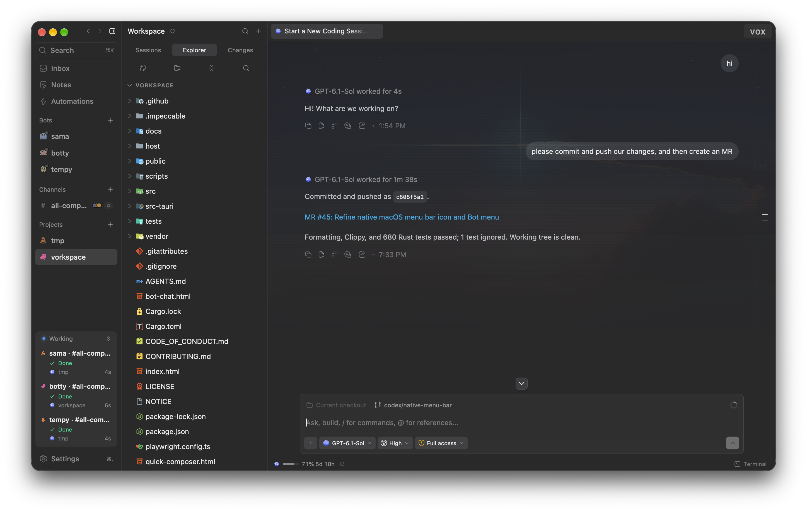
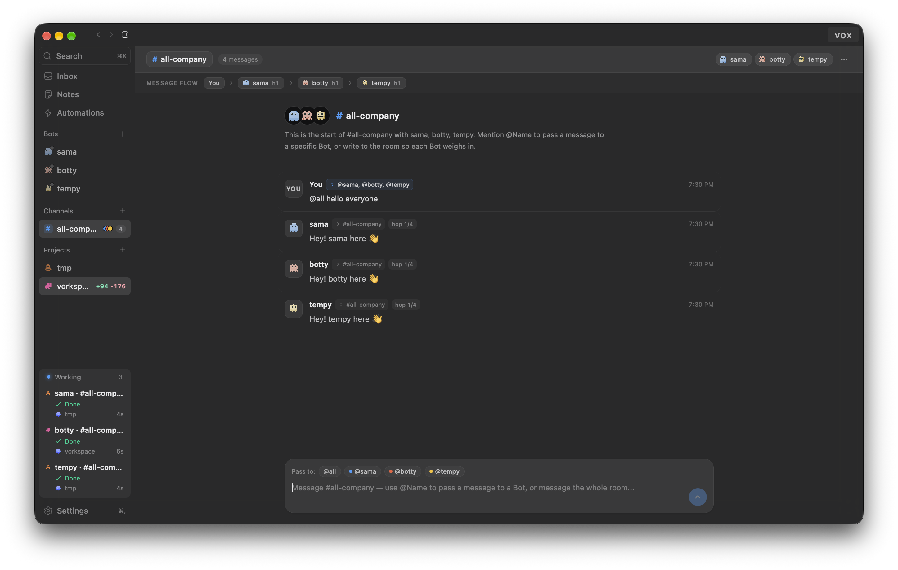

<p align="center">
  
</p>

<h1 align="center">vorkspace</h1>

<p align="center">
  <strong>A native desktop workspace and remote daemon for orchestrating coding agents.</strong>
</p>

<p align="center">
  <a href="https://github.com/vrnrn/vorkspace/releases/latest">Download macOS DMG</a> ·
  <a href="docs/providers.md">Provider Setup</a> ·
  <a href="docs/architecture.md">Architecture</a> ·
  <a href="docs/remote-access.md">Remote SSH</a> ·
  <a href="docs/building.md">Build from Source</a>
</p>

<p align="center">
  &nbsp;&nbsp;
  &nbsp;&nbsp;
  &nbsp;&nbsp;
  &nbsp;&nbsp;
  
</p>

---

**vorkspace** wraps the coding agent CLIs you already have installed—**Claude Code**, **OpenAI Codex**, **Antigravity**, **Pi**, and **omp**—into a unified, local-first workspace. Tabs are sessions, split panes run side by side, and every agent talks directly to its own CLI and credentials with zero token markup or middleman proxy.

vorkspace is based on [MonoCode](https://github.com/hardbeat920/monocode), created by [Nick (hardbeat920)](https://github.com/hardbeat920). Thanks to Nick and the upstream contributors for the foundation.

<p align="center">
  
</p>

<p align="center">
  
</p>

---

## Supported Providers

Install and sign in to at least one supported CLI. vorkspace probes for installed agents at startup and enables the ones it finds:

| Provider | CLI & Sign-In | Capabilities in vorkspace |
| :--- | :--- | :--- |
|  **[Claude Code](https://claude.com/product/claude-code)** | `claude auth login` | Multi-account switching with native transcript/checkpoint transfer, AWS Bedrock detection, and optional GitHub Copilot 1M models (`GPT-6.1 Sol`, `GPT-6 Luna`). |
|  **[Codex](https://developers.openai.com/codex/cli)** | `codex login` | Multi-account switching with rollout/subagent transfer, isolated Bot stores, and real-time **Vox** voice control. |
|  **[Antigravity](https://antigravity.google/docs/cli-install)** | `agy` *(macOS/Linux)* | Native stream-JSON session management, model catalog discovery, and worktree execution. |
|  **[Pi](https://pi.dev/)** | `npm i -g @earendil-works/pi-coding-agent` | Persistent JSON-RPC process adapter with live steering and tool streaming. |
|  **[omp](https://omp.sh)** | `curl -fsSL https://omp.sh/install \| sh` | High-speed ACP/stdio integration with shell-forwarded `COPILOT_GITHUB_TOKEN` support. |

See [Provider setup](docs/providers.md) ([ELI5](docs/eli5/providers.md)) for model visibility filtering, multi-account continuation, and GitHub Copilot setup.

---

## Core Capabilities

### Parallel Sessions, Git Worktrees & Code Review
- **Split-Pane Workspace**: Arrange agent sessions, CodeMirror 6 file editors, diffs, and integrated PTY terminals in arbitrary binary-tree split panes, or switch to the opt-in **Inset Glass Layout** (`Settings → Appearance → Layout`) with 11 dual-scheme dark/light workspace themes.
- **First-Class Git Worktrees**: Spin up isolated Git worktrees per task so parallel agents never clobber each other's working tree.
- **Turn Checkpoints & Worker-Backed Diffs**: Every agent turn snapshots modified files so you can roll back edits in one click. Review changes with off-thread Lezer syntax highlighting, hunk staging, and an interactive commit graph.
- **Seamless Account Continuation**: When a Claude Code or Codex account hits a rate limit mid-session, switch accounts directly from the banner—vorkspace copies native transcripts, subagent trees, and checkpoints byte-for-byte before resuming.

### Bots, Channels, Orchestrations & `/operator`
- **Bots**: Persistent cross-project agents backed by their own `SOUL.md` identity and `MEMORY.md` long-term memory, with a dedicated floating companion window, scheduled **Habits**, and multi-agent **Channels**.
- **Lead/Worker Orchestrations**: Decompose complex changes into a lead session and parallel worker sessions across isolated worktrees with enforced file write scopes.
- **`/operator` Mode**: Prefix any prompt with `/operator` to grant an agent scoped CLI access (`vorkspace app`) to open sessions, split panes, manage worktrees, and read or update workspace notes.

### Vox Voice Controller, Triage Inbox & Remote SSH
- **Vox Voice Controller**: Talk hands-free over WebRTC (`gpt-live-1-codex`) to inspect active work, create or steer sessions, and message Bots without touching the keyboard.
- **Unified Inbox & CI Auto-Repair**: Triage GitHub PRs/issues, GitLab MRs/issues, and Jira Cloud tickets in one place, with automatic branch/commit ticket detection and one-click **CI Auto-Repair** when a PR check fails.
- **Headless Remote SSH Daemon (`vorkspace-host`)**: Connect to remote macOS, Linux, or Windows devboxes over OpenSSH (`127.0.0.1:3774`). Remote agents keep running while your laptop is closed and resynchronize state when you reconnect.

---

## Install

1. Install and sign in to at least one [supported provider](docs/providers.md).
2. Download the latest Apple Silicon DMG (`vorkspace_X.Y.Z_aarch64.dmg`) from [GitHub Releases](https://github.com/vrnrn/vorkspace/releases/latest).
3. Open the DMG and drag `vorkspace.app` to `~/Applications` (or `/Applications`).

See the [Installation guide](docs/install.md) ([ELI5](docs/eli5/install.md)) for first-launch Gatekeeper instructions, or [Building from source](docs/building.md) ([ELI5](docs/eli5/building.md)) for Linux and Windows builds.

---

## Documentation

Every technical guide in [`docs/`](docs/) is paired with a plain-English companion in [`docs/eli5/`](docs/eli5/):

| Guide | Technical Doc | Plain-English (ELI5) |
| :--- | :--- | :--- |
| **System Architecture** | [docs/architecture.md](docs/architecture.md) | [docs/eli5/architecture.md](docs/eli5/architecture.md) |
| **Provider Setup & Accounts** | [docs/providers.md](docs/providers.md) | [docs/eli5/providers.md](docs/eli5/providers.md) |
| **Installation** | [docs/install.md](docs/install.md) | [docs/eli5/install.md](docs/eli5/install.md) |
| **Agent Access (`/operator`)** | [docs/agent-access.md](docs/agent-access.md) | [docs/eli5/agent-access.md](docs/eli5/agent-access.md) |
| **Vox Voice Controller** | [docs/vox.md](docs/vox.md) | [docs/eli5/vox.md](docs/eli5/vox.md) |
| **Jira Cloud Inbox** | [docs/jira.md](docs/jira.md) | [docs/eli5/jira.md](docs/eli5/jira.md) |
| **Ticket Context Links** | [docs/ticket-context.md](docs/ticket-context.md) | [docs/eli5/ticket-context.md](docs/eli5/ticket-context.md) |
| **Remote SSH Sessions** | [docs/remote-access.md](docs/remote-access.md) | [docs/eli5/remote-access.md](docs/eli5/remote-access.md) |
| **Building from Source** | [docs/building.md](docs/building.md) | [docs/eli5/building.md](docs/eli5/building.md) |

---

## Build from Source

Requires **Node.js 20+** (Node.js 24+ for the remote host daemon) and a **stable Rust toolchain**:

```bash
npm install
npm run tauri dev
```

Before opening a pull request, read [CONTRIBUTING.md](CONTRIBUTING.md) and [AGENTS.md](AGENTS.md), and run the full check suite:

```bash
npm run check
```

---

## License

vorkspace is distributed under the [MIT license](LICENSE). Provider names and logos are trademarks of their respective owners. See [NOTICE](NOTICE) for attribution.
